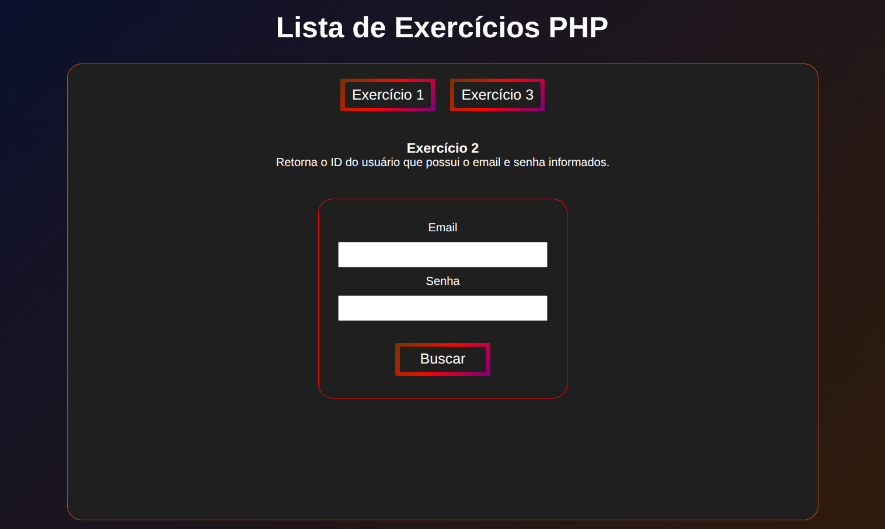
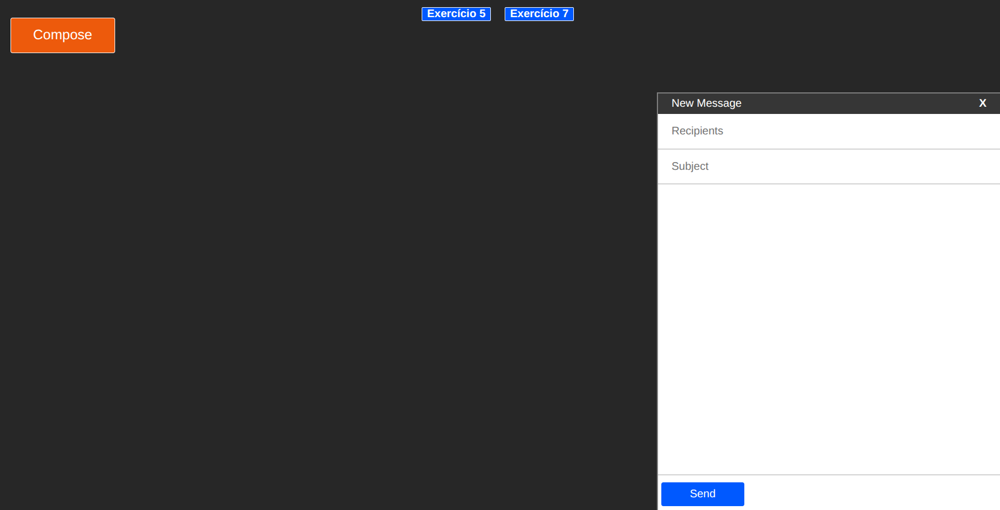

# 💻 Programming II — PHP & JavaScript Exercises

A collection of exercises developed as the final assignment for the **Programming II** course during my Computer Science degree.

The project consists of two exercise sets focused on web development fundamentals.

All CSS styling were implemented from scratch, without relying on external libraries or frameworks.

## 📁 Exercise Sets

### 1. PHP & SQLite

A set of 15 exercises covering server-side programming and database operations, including user registration, authentication, CRUD operations, SQL queries, and session management.

**Technologies:** PHP, SQLite, PDO, HTML, and CSS.

**[📄 Assignment — PHP.pdf](PHP.pdf)**



### 2. JavaScript

A set of 10 exercises exploring client-side programming, DOM manipulation, event handling, AJAX requests, and interactive web interfaces.

**Technologies:** JavaScript, HTML, CSS, and PHP for server-side endpoints.

**[📄 Assignment — Javascript.pdf](Javascript.pdf)**



## 🚀 Running Locally

**Requirements:** PHP with SQLite support (`php-sqlite3`).

To run either exercise set, open a terminal inside its respective directory (`Lista PHP` or `Lista JS`) and start the PHP development server:

```bash
php -S localhost:8000
```

Then access the corresponding URL:

- **PHP exercises:** http://localhost:8000/home
- **JavaScript exercises:** http://localhost:8000/exercicio1.html

Each exercise set should be run separately, using its own directory as the server root.
